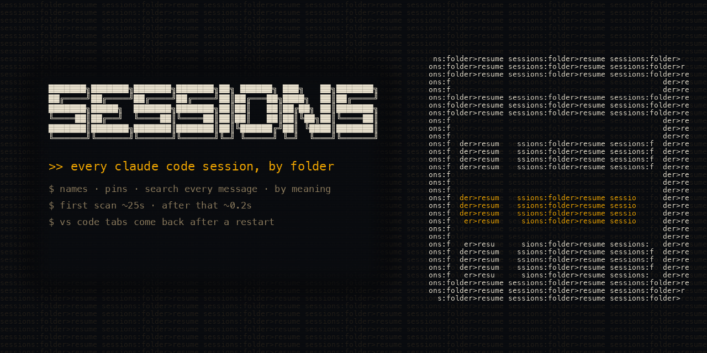

<p align="center"></p>

# Sessions

A Claude Code mod that keeps a pane beside the chat with every session you started, grouped by the folder it ran in. You can name sessions, pin the ones you keep coming back to, search every message you and Claude wrote, and reopen a closed session in VS Code with one press. A small VS Code extension that comes with it brings your open Claude terminal tabs back after VS Code restarts, and a few lines in `~/.zshrc` do the same for macOS Terminal.

[Türkçe açıklama aşağıda.](#türkçe)

```
Search: backup
found in the messages of 2 sessions · 1 related by meaning
42 sessions · 9 folders · 3 live

★ Pinned 1
  ● Release checklist · shop-app · working

▾ scripts 4 · 3 min · 1 live
  ~/code/scripts
  ● Nightly backup script · idle
      you: why does the backup skip on sundays
  ○ Webhook retries · 2 d
      by meaning: mentions rsync, cron
```

## What it does

- **Lists every session you started.** It reads the transcripts under `~/.claude/projects`, leaves out subagents, SDK runs and automated runs that never had a typed prompt, and groups the rest by folder, newest first. Live sessions show a green or yellow dot.
- **Names.** A session shows the name you gave it in the pane, then its `/rename` name, then Claude's own title, then a short title Haiku writes from the first message, then the first message itself. A name you give a closed session is also written into its transcript, so `claude --resume` shows it too.
- **Pins.** Pinned sessions sit in their own block at the top.
- **Search.** Typing filters titles and folders. Enter searches the text of every message, and at the same time asks Haiku for related words and searches for those, so "deploy" also finds the session where you only said "release".
- **Resume in VS Code.** Pick a closed session and press "Open in VS Code": it opens in a new terminal tab in the session's folder.
- **Tabs survive a restart.** The VS Code extension remembers which terminal tab runs which Claude session. When VS Code comes back, it resumes each one in its tab, under the session's name. macOS Terminal tabs do the same with the snippet below.

The first scan of 16,500 transcripts took about 25 seconds on my Mac; after that a refresh takes about 0.2 seconds, because only changed files are read again.

## Install

At the prompt of a Claude Code terminal session:

```
/plugin install sessions --marketplace kasparovabi/claude-sessions
```

Answer `y` to add the marketplace, then pick a scope (user scope loads it in every session). From a shell:

```
claude plugin install sessions --marketplace kasparovabi/claude-sessions
```

The pane opens by itself in interactive sessions once the terminal is wide enough. `/sessions` (`/oturumlar` in Turkish) opens and focuses it.

### VS Code extension (for "Open in VS Code" and tab restore)

Download `claude-sessions-vscode-1.0.0.vsix` from the [latest release](https://github.com/kasparovabi/claude-sessions/releases/latest), then:

```
code --install-extension claude-sessions-vscode-1.0.0.vsix
```

Then run **Developer: Reload Window** in every VS Code window that is already open. A window opened before the install does not run the extension, and its tabs are not remembered until it is reloaded.

Tab restore works best with `"terminal.integrated.defaultLocation": "editor"` and VS Code's persistent terminal sessions on (the default).

### macOS Terminal tabs

The mod writes the session each Terminal tab runs to `~/.claude/oturumlar-sekmeler/<tab id>` and empties it when you leave the session yourself (`/exit`, ctrl+c, ctrl+d). When Terminal brings a tab back, this snippet at the end of `~/.zshrc` resumes the session in it, in the same folder and with `--dangerously-skip-permissions` only if the session was started with it:

```zsh
if [[ $TERM_PROGRAM == Apple_Terminal && $TERM_SESSION_ID =~ '^[A-Za-z0-9:-]+$' && -r ~/.claude/oturumlar-sekmeler/$TERM_SESSION_ID ]]; then
  () {
    local -a r=("${(@f)$(<$1)}") t
    rm -f -- $1
    [[ $r[1] =~ '^[0-9a-f]{8}(-[0-9a-f]{4}){3}-[0-9a-f]{12}$' ]] || return
    t=(~/.claude/projects/*/$r[1].jsonl(N))
    (( $#t )) && ! pgrep -qf -- $r[1] && cd -- $r[3] 2>/dev/null || return
    if [[ $r[2] == 1 ]]; then claude --dangerously-skip-permissions --resume $r[1]; else claude --resume $r[1]; fi
  } ~/.claude/oturumlar-sekmeler/$TERM_SESSION_ID
fi
```

Terminal brings tabs back after a restart when "Reopen windows when logging back in" is ticked. To get them back after quitting Terminal with ⌘Q too:

```
defaults write com.apple.Terminal NSQuitAlwaysKeepsWindows -bool true
```

## Settings

| Where | Setting | What it does |
| --- | --- | --- |
| Claude Code `/config` | `vscodeCli` | The `code` command of the VS Code that should open sessions, for a second or renamed VS Code install. Empty: the system's `vscode://` handler opens them. |
| VS Code settings | `claudeSessions.skipPermissions` | Off by default. On: sessions resume with `--dangerously-skip-permissions`, so Claude runs tools without asking first. Turn it on only if you already work that way. |

The pane speaks Turkish when Claude Code's `language` setting is Turkish (or, with no setting, when the locale starts with `tr`), and English otherwise.

## Requirements

- A Claude Code build with mods (function-hook plugins).
- `node` on the `PATH`, or at `/opt/homebrew/bin/node` or `/usr/local/bin/node`. The indexer and search run as small Node scripts.
- VS Code 1.90 or newer for the extension. Tested on macOS and Windows.

## What it stores and what leaves your machine

Everything stays under `~/.claude`:

| File | Holds |
| --- | --- |
| `oturumlar-index.json` | The index of your transcripts (folder, titles, first message, times) |
| `oturumlar-metin/<id>.txt` | The plain text of each session's messages, for search |
| `oturum-adlari.json` | Names you gave in the pane |
| `oturum-otomatik-adlari.json` | Titles Haiku wrote |
| `oturum-sabitler.json` | Pinned session ids |
| `oturumlar-sekmeler/<tab id>` | The session a macOS Terminal tab runs, for resuming it |

Two things go to the model through your own Claude Code login: the first message of a session that has no name or title (to write a title, three sessions per pass), and the words you search for when you press Enter. No transcript is sent anywhere else.

## Development

```
claude plugin validate .
claude plugin test .
node --test vscode/restore.test.js
```

To build the extension: `cd vscode && npx @vscode/vsce package --skip-license`.

## Türkçe

Claude Code için bir mod: başlattığın her oturumu, çalıştığı klasöre göre gruplanmış hâlde sohbetin yanındaki bir panelde gösterir. Oturumlara ad verebilir, sık döndüklerini en üste sabitleyebilir, senin ve Claude'un yazdığı her mesajda arayabilir, kapalı bir oturumu tek tuşla VS Code'da açabilirsin. Yanındaki küçük VS Code eklentisi, VS Code kapanıp açılınca açık Claude sekmelerini aynı yerlerine ve adlarıyla geri getirir.

Kurulum, Claude Code terminal oturumunda:

```
/plugin install sessions --marketplace kasparovabi/claude-sessions
```

VS Code eklentisi için [son sürümdeki](https://github.com/kasparovabi/claude-sessions/releases/latest) `.vsix` dosyasını indirip `code --install-extension claude-sessions-vscode-1.0.0.vsix` çalıştır, sonra açık her pencerede bir kez **Developer: Reload Window** yap. Yeniden yüklenmeyen pencere eklentiyi çalıştırmaz ve sekmeleri hatırlanmaz.

macOS Terminal sekmelerinin de geri açılınca oturumlarıyla gelmesi için yukarıdaki "macOS Terminal tabs" parçasını `~/.zshrc` dosyasının sonuna ekle. Terminal'den ⌘Q ile çıkınca da sekmelerin geri gelmesini istiyorsan oradaki `defaults write` satırını bir kez çalıştır.

Claude Code'un `language` ayarı Türkçe ise panel Türkçe konuşur, komut `/oturumlar` olur. Oturumları `--dangerously-skip-permissions` ile açmak istersen VS Code ayarlarında `claudeSessions.skipPermissions` seçeneğini aç; varsayılan kapalıdır.

## License

MIT
